# DSO183 custom firmware

Replacement firmware for the JYE Tech DSO183 (18301K) digital storage
oscilloscope. A modular, host-testable firmware built from analysis of the
stock instrument: acquisition (ADC1 → DMA1 → circular buffer), a software
trigger engine, the ILI9341-compatible display driver, the front-panel
ladder switches, and a CRC-framed PC link over the console UART.

This is an **open-source community project**, not a competition to produce the
most sophisticated firmware. The objective is to improve the original DSO183,
make its capabilities and internals accessible, and create a foundation that
other people can build upon. Bug reports, suggestions, fixes and contributions
are welcome.

## Status

**Pre-release (active development).** Firmware source, host tests, and tooling are published in this repository (`main`). The firmware is a working scope core — display, acquisition, front-panel decode, trace and the PC link are real and have been verified on the bench — but it is **not yet a product**. Several stock features are partially implemented or missing: RMS/frequency/duty maths exist but only Vpp is shown on the panel; save/load waveform and some stock display/parity items remain incomplete; per-sensitivity calibration is stored but not yet applied to the trace.

**Current instrument state (B4.36, 2026-11-15, single tested instrument):** candidate **build_seq 41320** (`dso183.bin` 40,960 B, SHA-256 `bfa6e7bf8bf681d202dba6267b5b8443d6ccd7fd2a2e234d9f1b0b7cc40e7efd`; flash 40,956/61,440 B 66%, RAM 18,680/20,480 B 91%) is deployed on the instrument and verified (safe page-wise flash via `tools/flash_cycle.py`, page 0 last, per-page/full readback + RAM identity; UART `BUILD_SEQ 41320`, `STATUS 1`).

- **50 µs/div trigger (B4.36, hardware-validated):** the 50 µs/div rising-edge misalignment (0/100 valid rising placements on 48462/B4.34) is fixed by span-bounded edge anchoring with coherent per-capture diagnostics. A 12-config × 50-capture campaign (tb5/tb6/tb9, AUTO/NORM, rise/fall, 1 kHz 50% square) produced **600/600 coherent captures, 0 no-frame, 0 diag errors, 0 rejected frames**. **tb5 rising:** AUTO 50/50 and NORM 50/50 with the requested rising crossing within ±2 of index 96 (actual 96 / 95–96). tb5 falling and all tb6/tb9 cases 50/50 at 96. Diagnostics: `refined_found=1`, `fallback=0`, `anchor_kind=0` (local) throughout this run. Host validation: 36 suites, 1,318 checks, 0 failures. See `B4_36_TRIGGER_FIX_AND_VALIDATION_REPORT.md`.
- **ETS / fastest timebases (implemented, prior hardware evidence):** TB0–TB4 (1–20 µs/div) are equivalent-time (ETS/REPT) ranges, not real-time single-shot. ETS was not re-campaigned on 41320; B4.32 hardware validation (build 12066, B2 Amendment A + B-REC) showed **TB4** fast-undersampled square met coverage/ready in captured coherent evidence (fill 128, ready), **TB2/TB3** did not reach the 80-bin gate in captured windows, and **TB0/TB1** fast aperture-unresolved square were coverage-limited (80-bin metric reported, no PASS/FAIL per B-REC). Resolved sine/triangle (AC-2) was not tested (no signal source). Normal/stream/control checks in that campaign showed no regression in tested scope. Detailed B4.32 campaign artifacts live under `evidence/` (gitignored, local).
- **Recovery:** preserved 14139 full-flash recovery image (SHA-256 `e2bd129fd044f44246e9c5a85547d92f2559f6b25ee72ced4d7fe0eff09949f8`) and historical evidence remain intact.

**Your responsibility:** images in `build/` and `evidence/` are gitignored and rebuilds/flashes from your checkout are your responsibility. Bench conditions, instrument revision, and results may differ. Flash only through safe, page-wise, read-back-verified tooling with explicit authorisation — **never `st-flash write`** (STM32F1 mass-erase risk to reserved calibration/settings/device data).

## Bench Photos

Real hardware bench validation photos of the JYE Tech DSO183 running the custom
firmware (all taken on the single tested instrument: STM32F103 medium-density
rev A, display controller ID 0x858552). Captions describe what the photo was
intended to show; some are part of an investigation sequence and may not show
the behavior perfectly.

| Photo | Description |
|-------|-------------|
| 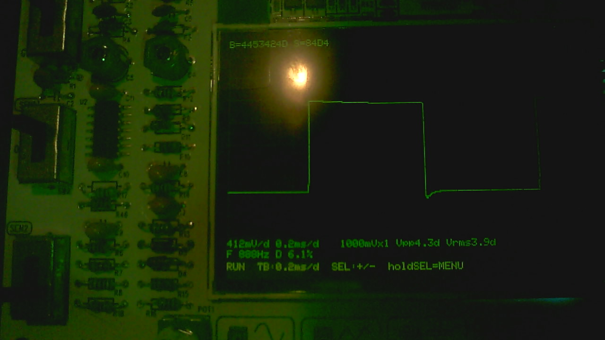 | Initial boot screen |
| 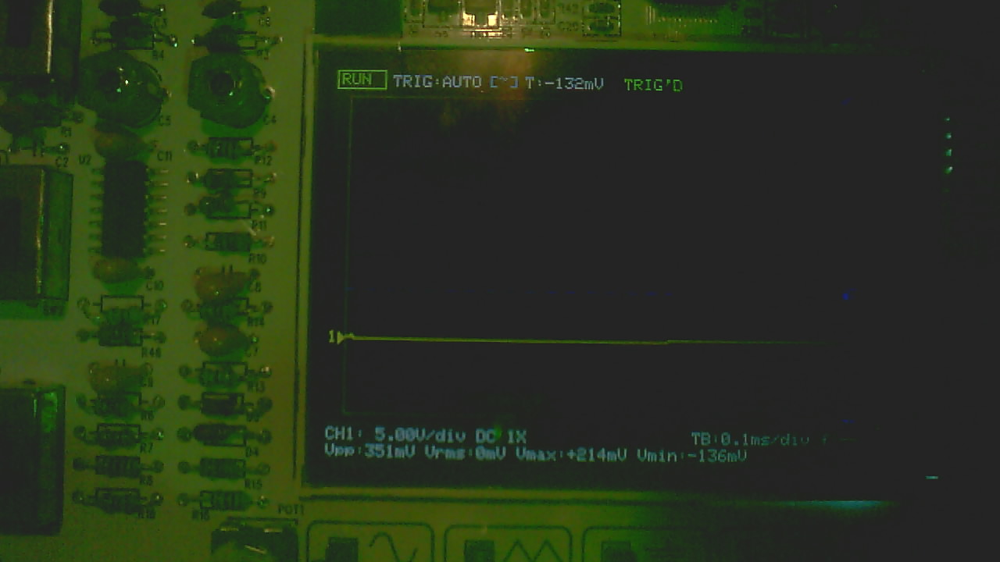 | Live waveform trace on the display |
| 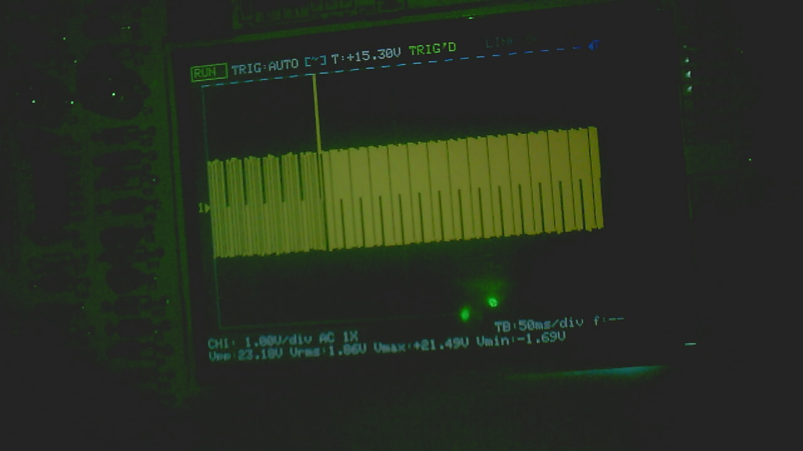 | 50 µs/div timebase screen (investigation photo) |
| 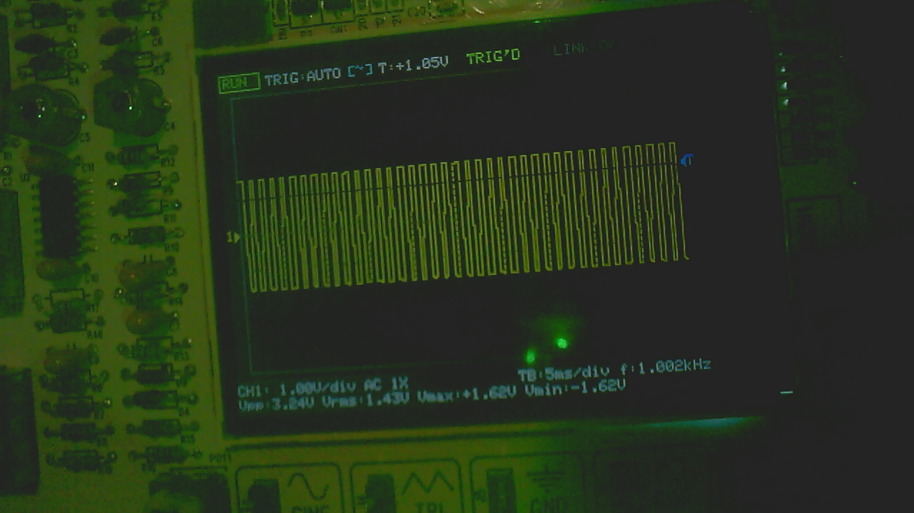 | Trigger test photo (investigation sequence) |
|  | RUN mode, 1 ms/div, AUTO trigger |
| 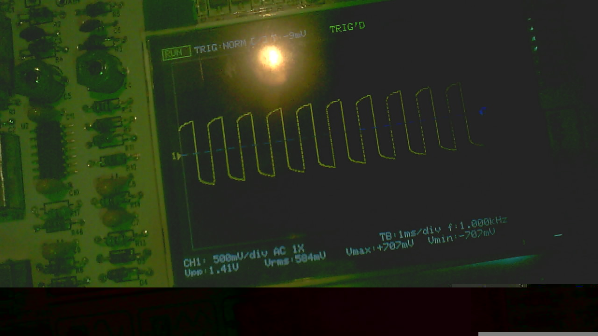 | NORM trigger mode, 1 ms/div |
| 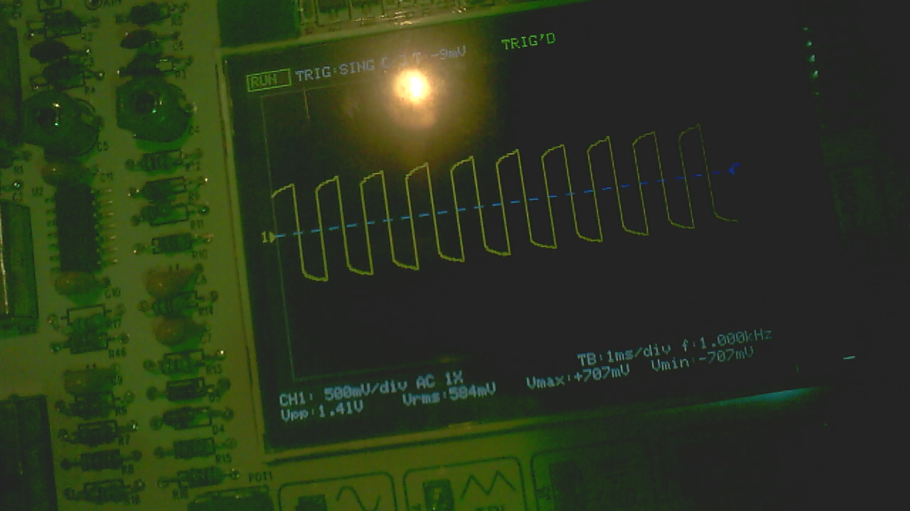 | SINGLE trigger mode, 1 ms/div |
|  | HOLD mode, 1 ms/div |

More bench photos (boot screen, span test, final trace, top positions, remote
verify sequence through all trigger modes, and a choppy-trace investigation
sequence) are in `docs/images/bench/`.

## UI Design Mockups

UI design mockups from `ui_design/UI_SPECIFICATION.md` — these show the
intended layout and aesthetic of the firmware's user interface:

| Mockup | Description |
|--------|-------------|
| 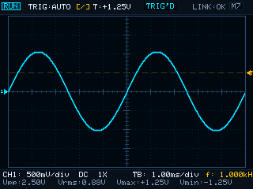 | Main screen — RUN mode |
| 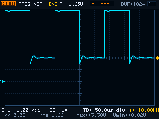 | Main screen — HOLD mode |
| 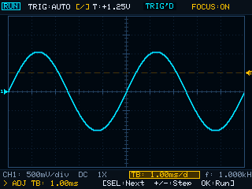 | Quick-focus overlay |
| 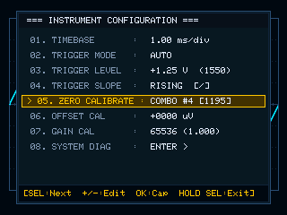 | Settings menu |
| 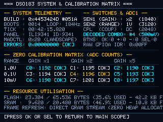 | SYSTEM DIAG screen |

More mockups are in `docs/images/ui/`.

## What the firmware provides

| Area | Capability | Verification |
|------|-----------|--------------|
| Display | ILI9341-compatible 320×240 RGB565 panel, 10×8 dotted graticule, live trace, persistent header (RUN/HOLD, trigger mode/slope/level, TRIG'D/WAIT, link status), settings menu, full-screen SYSTEM DIAG | Bench-verified |
| Acquisition | ADC1 channel 2 (PA2) → DMA1 channel 1 → 1024-sample circular buffer; immutable snapshot frozen on trigger; bounded waits | Bench-verified (partly) |
| Timebase | TIM3-paced ADC conversions, 1 µs/div … 50 s/div table (24 steps, capped at 50 s/div). TB5+ (50 µs/div and slower) are real-time single-shot; TB0–TB4 (1–20 µs/div) are equivalent-time (ETS/REPT) ranges | Table host-tested; TB5/TB6/TB9 real-time bench-validated on 41320; ETS evidence per B4.32 (range/waveform dependent) |
| Trigger | ADC analog watchdog, one-sided band with hysteresis, span-bounded edge anchoring/refinement, AUTO / NORM / SINGLE policies, trigger-aligned averaging, coherent per-capture diagnostics (GETV latch protocol) | Host-tested; 50 µs/div rise/fall and 0.1/1 ms rise/fall hardware-validated on 41320 (600/600 coherent) |
| Front panel | Four pushbuttons (PB12 OK, PB13 +, PB14 −, PB15 SEL); three slide switches read via ADC1 resistor ladder (gain ×1/×2/×5, range 10 mV/0.1 V/1 V, coupling AC/DC/GND); nine sensitivity combinations | Switch decode bench-verified; coupling switch is analogue-only (not observable by the MCU) |
| Measurements | Vpp, Vrms, Vmax, Vmin (integer, 64-bit sums, no floating point); frequency/duty require a periodic signal — bench validation required | Maths host-tested; Vpp shown on panel; others computed but not all displayed |
| Calibration | CRC records in reserved flash (never erased by image writes), two alternating settings slots, base offset/gain pair, nine-entry per-sensitivity zero table, CAL ZERO menu page | Storage host-tested; absolute volts/div scaling from the base pair not yet applied (needs a measured reference) |
| PC link | CRC-16/CCITT-framed commands and replies over USART1 (115200 8N1): NOP, SET_TIMEBASE, SET_TRIGGER, SET_SPAN, RUN, STOP, GET_STATUS, STREAM, GET_VALUE (incl. coherent trigger/ETS diagnostics) | Verified on hardware |
| Watchdog | IWDG armed, fed every superloop iteration/bounded waits, ~10 s timeout | Verified |

## Hardware identification & compatibility

This firmware targets the **JYE Tech DSO183 (18301K)** built around the
**STM32F103C8T6** (ARM Cortex-M3, 64 KiB flash, 20 KiB SRAM, no FPU) driving
an ILI9341-compatible 320×240 parallel display.

**Tested revision:** exactly one instrument (STM32F103 medium density rev A,
display controller ID read back as 0x858552 — a compatible controller, not a
genuine ILI9341 — which accepts the 9341 init sequence). Compatibility with
other DSO183 hardware revisions, clones, or display panels has **not** been
tested and is not claimed. See `docs/HARDWARE.md` for the pin map, the
display-controller caveat, and the specific identification values observed on
the tested unit.

## Build, installation and flashing

### Prerequisites

* `arm-none-eabi-gcc` (tested with 13.2.1) and `arm-none-eabi-size`,
  `arm-none-eabi-objcopy`
* GNU Make
* Python 3 (for the host test harness and tooling)
* For flashing only: `pyocd` (used by `tools/flash_cycle.py` / page-wise tools). Flashing must be explicitly authorised and performed via the safe, page-wise, read-back-verified path.

### Build

From the repository root:

```bash
make            # firmware image (build/dso183.bin, .hex, .elf) + size report
make test       # host unit tests (native compiler, no HAL needed)
make guard      # static safety checks
make check      # build + tests + size + documentation/artefact cross-check (if configured)
make size       # flash/RAM budget report
```

### Flashing (user-controlled only)

This project **never flashes your instrument for you**. You perform the flash
through a safe page-wise, read-back-verified path (page 0 last) and **never**
with `st-flash write` (STM32F1 mass-erase risk; can destroy calibration/settings
and the vendor device record).

For a full controlled image flash when explicitly authorised, use
`tools/flash_cycle.py` with the image and ELF, and verify identity/readback:

```bash
python3 tools/flash_cycle.py --image build/dso183.bin --elf build/dso183.elf
```

See `FLASH_HANDOVER.md` for the flash procedure, reserved flash map
(settings, calibration, waveform slots, device record) and recovery guidance.

## Repository layout

```
app/            firmware: acquisition, trigger/anchoring, ETS, timebase, measurements,
                calibration, UI/menu, PC link, flash store, run state
drivers/        vendored STM32F1xx HAL (ST) + CMSIS (ARM) + ILI9341 display driver
fonts/          Adafruit GFX 5x7 font (vendored, BSD) + glyph rasteriser
linker/         STM32F103C8 linker script (60 KiB app, last 4 KiB reserved)
startup/        vector table + reset handler
tests/          host unit tests (native, no HAL)
tools/          build/release helpers, flash tools, protocol/validation utilities
docs/           project documentation (architecture, hardware, features,
                limitations, roadmap, licensing)
ui_design/      UI-SPEC-001 mockups and specification (design artifacts,
                not build inputs)
build/          gitignored: compiled artefacts (never committed)
evidence/       gitignored: local bench/campaign evidence (never committed)
```

## Verified features, experimental features and known limitations

See `docs/FEATURES.md` for the honest breakdown: what is bench-verified, what
is host-tested only, what is experimental, and the known limitations. Key
current points: 50 µs/div rising-edge trigger is now hardware-validated on
41320 (B4.36); ETS/TB0–TB4 behaviour is range- and waveform-dependent per prior
evidence and not blanket-proven; several stock/product-parity features remain
incomplete.

## Roadmap

See `docs/ROADMAP.md`: measurement readouts beyond Vpp, frequency/duty, save/load
waveform parity, display/calibration polish, broader ETS validation, and further
hardening.

## Development setup

See `docs/development.md`: toolchain install, clone/build/test cycle, running
the host test suite, and safe flash guidance.

## Community

* `CONTRIBUTING.md` — how to build, test and submit pull requests
* `CODE_OF_CONDUCT.md` — community standards
* `SECURITY.md` — security disclosure policy (if present)
* Issue templates (`.github/ISSUE_TEMPLATE/`)

## AI-assisted development

This project uses AI-assisted coding and research tools. Architecture
decisions, engineering direction, hardware experimentation, validation and
project management are human-directed. See `AI_METHODOLOGY.md` for the
factual statement.

## License

See `LICENSE` and `docs/LICENSING.md`.

**Important:** this project was developed by reverse-engineering the JYE Tech
DSO183 stock firmware. The original vendor binary and the Ghidra
reverse-engineering workspace are **not part of this repository**. The custom
application code is original; third-party components (STM32 HAL, CMSIS,
Adafruit GFX font) retain their own copyright and license notices. Read
`docs/LICENSING.md` before redistributing.

---

*Questions? Open an issue. Want to help? Read CONTRIBUTING.md. We welcome
contributors at every experience level.*
