# DSO183 custom firmware

Replacement firmware for the JYE Tech DSO183 (18301K) digital storage
oscilloscope. A modular, host-testable firmware built from analysis of the
stock instrument: acquisition (ADC1 → DMA1 → circular buffer), a software
trigger engine, the ILI9341-compatible display driver, the front-panel
ladder switches, and a CRC-framed PC-link over the console UART.

This is an **open-source community project**, not a competition to produce the
most sophisticated firmware. The objective is to improve the original DSO183,
make its capabilities and internals accessible, and create a foundation that
other people can build upon. Bug reports, suggestions, fixes and contributions
are welcome.

> **Repository status:** Documentation and project infrastructure are being
> published first. Firmware source is still under active development and will
> be published separately once the current implementation and validation work
> is ready.

---

## Status

**Pre-release (v0.1.0 baseline).** The firmware is a working scope core —
display, acquisition, front-panel decode, trace and the PC link are real and
have been verified on the bench — but it is not yet a product. Several stock
features are partially implemented or missing: RMS/frequency/duty maths exist
but only Vpp is shown on the panel; save/load waveform is absent;
per-sensitivity calibration is stored but not yet applied to the trace. The
five fastest timebases are not yet physically usable without equivalent-time
sampling.

The image in `build/` has **not been flashed** by the maintainer from this
exact tree; physical flash and bench validation remain the responsibility of
the person building it. Flash only through the safe page-wise writer
(`tools/flash/write_image.py`, `AUTHORIZED=1`) — never `st-flash write`, which
mass-erases the STM32F1 and destroys the stored calibration/settings.

## Bench Photos

Real hardware bench validation photos of the JYE Tech DSO183 running the custom
firmware (all taken on the single tested instrument: STM32F103 medium-density
rev A, display controller ID 0x858552). Captions describe what the photo was
intended to show; some are part of an investigation sequence and may not show
the behavior perfectly.

| Photo | Description |
|-------|-------------|
| 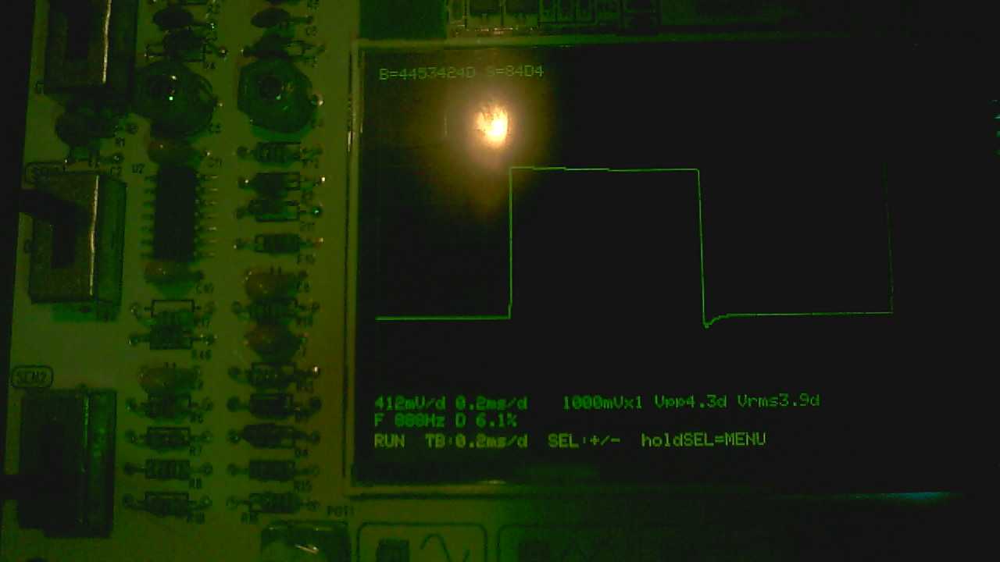 | Initial boot screen |
| 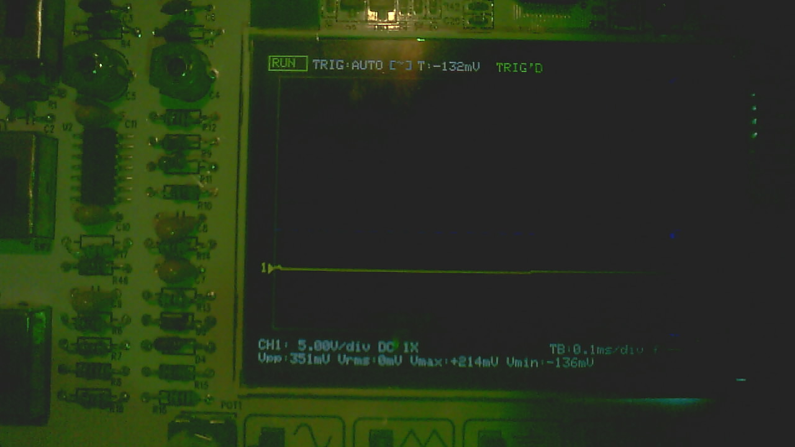 | Live waveform trace on the display |
| 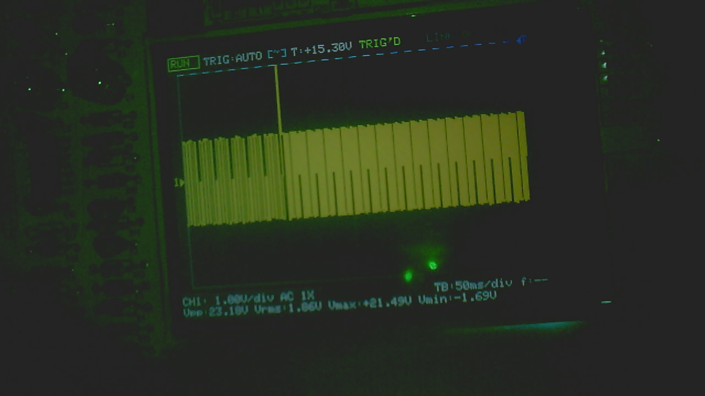 | 50 µs/div timebase screen (investigation photo) |
| 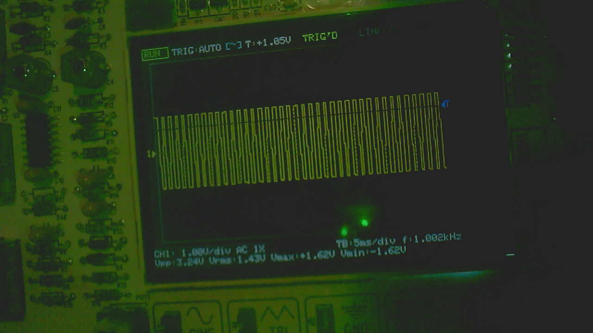 | Trigger test photo (investigation sequence) |
|  | RUN mode, 1 ms/div, AUTO trigger |
| 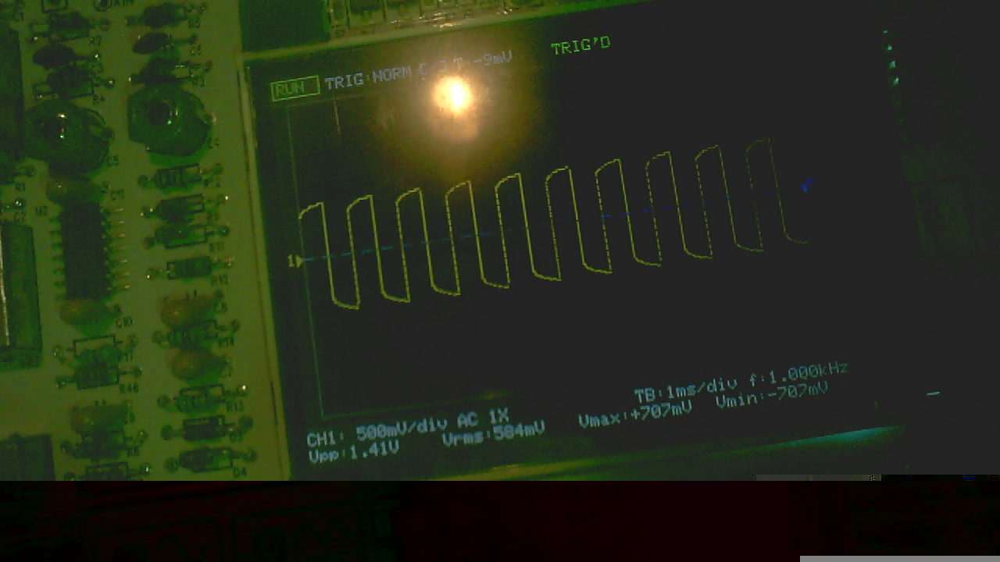 | NORM trigger mode, 1 ms/div |
| 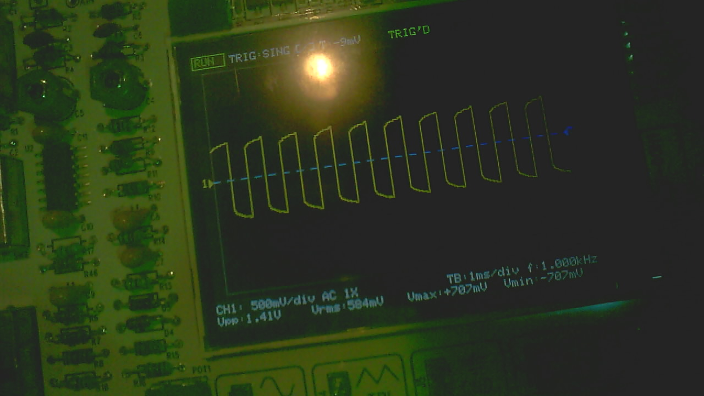 | SINGLE trigger mode, 1 ms/div |
|  | HOLD mode, 1 ms/div |

More bench photos (boot screen, span test, final trace, top positions, remote
verify sequence through all trigger modes, and a choppy-trace investigation
sequence) are in `docs/images/bench/`.

## UI Design Mockups

UI design mockups from `ui_design/UI_SPECIFICATION.md` — these show the
intended layout and aesthetic of the firmware's user interface:

| Mockup | Description |
|--------|-------------|
| 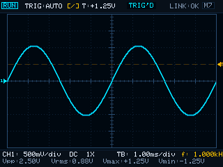 | Main screen — RUN mode |
| 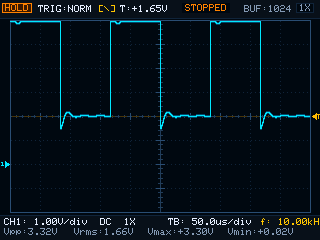 | Main screen — HOLD mode |
| 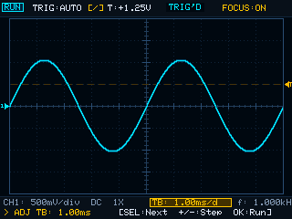 | Quick-focus overlay |
| 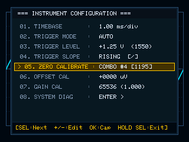 | Settings menu |
| 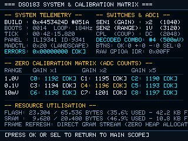 | SYSTEM DIAG screen |

More mockups are in `docs/images/ui/`.

## What the firmware provides

| Area | Capability | Verification |
|------|-----------|--------------|
| Display | ILI9341-compatible 320×240 RGB565 panel, 10×8 dotted graticule, live trace, persistent header (RUN/HOLD, trigger mode/slope/level, TRIG'D/WAIT, link status), settings menu, full-screen SYSTEM DIAG | Bench-verified |
| Acquisition | ADC1 channel 2 (PA2) → DMA1 channel 1 → 1024-sample circular buffer; immutable snapshot frozen on trigger; bounded waits | Bench-verified (partly) |
| Timebase | TIM3-paced ADC conversions, 1 µs/div … 50 s/div table (24 steps, capped at 50 s/div); 5 fastest steps (1–20 µs/div) flagged as equivalent-time-only, not yet paced by TIM3 | Table host-tested; pacing bench-verified down to 50 µs/div |
| Trigger | ADC analog watchdog, one-sided band with hysteresis, software edge refinement, AUTO / NORM / SINGLE policies, trigger-aligned averaging | Host-tested; bench-verified partly (50 µs/div falling edge verified, rising edge has a known misalignment under investigation) |
| Front panel | Four pushbuttons (PB12 OK, PB13 +, PB14 −, PB15 SEL); three slide switches read via ADC1 resistor ladder (gain ×1/×2/×5, range 10 mV/0.1 V/1 V, coupling AC/DC/GND); nine sensitivity combinations | Switch decode bench-verified; coupling switch is analogue-only (not observable by the MCU) |
| Measurements | Vpp, Vrms, Vmax, Vmin (integer, 64-bit sums, no floating point); frequency/duty require a periodic signal — bench validation required | Maths host-tested; Vpp shown on panel; others computed but not all displayed |
| Calibration | CRC records in reserved flash (never erased by image writes), two alternating settings slots, base offset/gain pair, nine-entry per-sensitivity zero table, CAL ZERO menu page | Storage host-tested; absolute volts/div scaling from the base pair not yet applied (needs a measured reference) |
| PC link | CRC-16/CCITT-FRAMED commands and replies over USART1 (115200 8N1): NOP, SET_TIMEBASE, SET_TRIGGER, SET_SPAN, RUN, STOP, GET_STATUS, STREAM (binary sample bursts) | Verified on hardware |
| Watchdog | IWDG armed, fed every superloop iteration, 10 s timeout | Verified |

## Hardware identification & compatibility

This firmware targets the **JYE Tech DSO183 (18301K)** built around the
**STM32F103C8T6** (ARM Cortex-M3, 64 KiB flash, 20 KiB SRAM, no FPU) driving
an ILI9341-compatible 320×240 parallel display.

**Tested revision:** exactly one instrument (STM32F103 medium density rev A,
display controller ID read back as 0x858552 — a compatible controller, not a
genuine ILI9341 — which accepts the 9341 init sequence). Compatibility with
other DSO183 hardware revisions, clones, or display panels has **not** been
tested and is not claimed. See `docs/HARDWARE.md` for the pin map, the
display-controller caveat, and the specific identification values observed on
the tested unit.

## Build, installation and flashing

### Prerequisites

* `arm-none-eabi-gcc` (tested with 13.2.1) and `arm-none-eabi-size`,
  `arm-none-eabi-objcopy`
* GNU Make
* Python 3 (for the host test harness, the documentation guard and the flash
  tools)
* For flashing only: pyocd (`write_page.py`) — the flash tools refuse to run
  without `AUTHORIZED=1` in the environment

### Build

From the repository root:

```bash
make            # firmware image (build/dso183.bin, .hex, .elf) + size report
make test       # host unit tests (native compiler, no HAL needed)
make guard      # static safety checks
make check      # build + tests + size + documentation/artefact cross-check
make size       # flash/RAM budget report
```

`make check` is the single command that answers "is this tree internally
consistent?". It verifies the built image against `FLASH_HANDOVER.md`, so the
documentation and the artefact always describe the same build.

### Flashing (user-controlled only)

This project **never flashes your instrument for you**. The maintainer does
not flash hardware. You perform the flash, through the safe page-wise path:

```bash
make flash-dry                                    # lists pages, writes nothing
AUTHORIZED=1 python3 tools/flash/write_image.py \
    --image build/dso183.bin                      # page-wise, read-back verified
```

Never use `st-flash write` on the STM32F1: it mass-erases the chip and
destroys the calibration/settings storage pages and the vendor device record.
See `FLASH_HANDOVER.md` for the full flash procedure, the reserved flash map
(settings, calibration, waveform slots, device record) and the recovery path.

## Repository layout

```
app/            firmware: acquisition, trigger, timebase, measurements,
                calibration, UI/menu, PC link, flash store, run state
drivers/        vendored STM32F1xx HAL (ST) + CMSIS (ARM) + ILI9341 display driver
fonts/          Adafruit GFX 5x7 font (vendored, BSD) + glyph rasteriser
linker/         STM32F103C8 linker script (60 KiB app, last 4 KiB reserved)
startup/        vector table + reset handler
tests/          host unit tests (native, no HAL)
tools/          build/release helpers, flash tools (page-wise writer),
                documentation guard, PC-link host tests
docs/           project documentation (architecture, hardware, features,
                limitations, roadmap, licensing)
ui_design/      UI-SPEC-001 mockups and specification (design artifacts,
                not build inputs)
build/          gitignored: compiled artefacts (never committed)
```

## Verified features, experimental features and known limitations

See `docs/FEATURES.md` for the honest breakdown: what is bench-verified, what
is host-tested only, what is experimental, and the known limitations —
including the three P0 defects the audit found (flash page sharing between
settings and calibration, Vpp readout dimensions, bidirectional trigger level)
and their remediation status.

## Roadmap

See `docs/ROADMAP.md`: measurement readouts beyond Vpp, frequency/duty,
save/load waveform, average/cycle display modes, per-sensitivity calibration
applied to the trace, dirty-rectangle rendering, link measurement queries, and
equivalent-time / repetitive (ETS/REPT) sampling for the five fastest
timebases.

## Development setup

See `docs/development.md`: toolchain install, clone/build/test cycle, running
the host test suite, the documentation guard, and the dry-run flash path.

## Community

* `CONTRIBUTING.md` — how to build, test and submit pull requests
* `CODE_OF_CONDUCT.md` — community standards
* `SECURITY.md` — security disclosure policy
* Issue templates for bug reports and feature requests (`.github/ISSUE_TEMPLATE/`)

## AI-assisted development

This project uses AI-assisted coding and research tools. Architecture
decisions, engineering direction, hardware experimentation, validation and
project management are human-directed. See `AI_METHODOLOGY.md` for the
factual statement.

## License

See `LICENSE` and `docs/LICENSING.md`.

**Important:** this project was developed by reverse-engineering the JYE Tech
DSO183 stock firmware. The original vendor binary and the Ghidra
reverse-engineering workspace are **not part of this repository** (licensing
reasons). The custom application code is original; third-party components
(STM32 HAL, CMSIS, Adafruit GFX font) retain their own copyright and license
notices. Read `docs/LICENSING.md` before redistributing.

---

*Questions? Open an issue. Want to help? Read CONTRIBUTING.md. We welcome
contributors at every experience level.*
