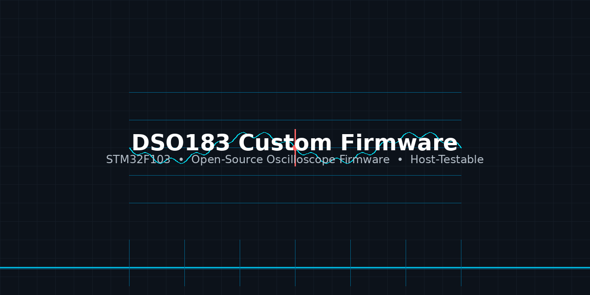

# DSO183 custom firmware

**A modular, open-source replacement firmware for the JYE Tech DSO183 (18301K) digital storage oscilloscope.**

[](LICENSE)
[](docs/HARDWARE.md)
[](docs/ROADMAP.md)
[](CONTRIBUTING.md)

The **JYE Tech DSO183** is a small, low-cost single-channel digital storage
oscilloscope. It is built around an **STM32F103C8T6** — a Cortex-M3 with 64 KiB
of flash, 20 KiB of RAM and no floating-point unit — driving a 320×240 colour
LCD and a simple analogue front end. The stock firmware works, but it is closed
and difficult to extend.

This repository is an **independent replacement firmware written from scratch**.
It gives the DSO183 a readable, modular scope core: acquisition, software
triggering, timebase control, display, a front-panel menu and a serial PC link.
The code is designed to be studied, tested on a normal desktop and built upon.

A surprising amount of oscilloscope fits into a very small microcontroller:

- **A working acquisition pipeline** — a 12-bit ADC feeds a DMA ring buffer,
  paced by a hardware timer, with snapshots frozen on trigger.
- **Software edge anchoring** — the trigger combines the ADC's analogue watchdog
  with a verified-edge search, so the displayed waveform is aligned to the
  requested edge rather than to a raw level-crossing interrupt.
- **No framebuffer** — a 320×240 RGB565 image alone would need 150 KiB, more
  than seven times the available RAM. The firmware renders directly to the
  display's GRAM in small windows.
- **Host-testable core** — 36 native test suites run on a PC without any STM32
  hardware.
- **Honest documentation** — features are labelled bench-verified, host-tested,
  experimental or planned. The engineering reports and limitations are part of
  the repository.

**Jump to:** [Current status](#current-status) ·
[Features](#features) · [Hardware compatibility](#hardware-compatibility) ·
[Getting started](#getting-started) · [Roadmap](#development-roadmap) ·
[Contributing](#contributing) · [Safety](#safety-and-disclaimers) ·
[Credits and licensing](#credits-and-licensing)

## A look at the project

| Real hardware (development build) | UI design mockups |
|---|---|
|  <br> *A live trace on the tested DSO183.* |  <br> *UI-SPEC-001 main screen — a design target, not a firmware screenshot.* |
|  <br> *RUN mode during a validation sequence.* |  <br> *SYSTEM DIAG design mockup.* |

More bench photos are in [`docs/images/bench/`](docs/images/bench/) and more UI
mockups in [`docs/images/ui/`](docs/images/ui/). The bench photos were taken
during development on the single tested instrument; they show the hardware and
UI, not a guarantee of the current build's exact appearance. The UI images are
design mockups, not screenshots.

## Current status

> **Active development, pre-1.0.** The scope core works and has been validated
> on real hardware. It is not yet feature-complete compared with the stock
> firmware, and it is not a commercial product. The
> [`v0.1.0`](https://github.com/benleveque1-design/Bens-Custom-DSO183-Firmware/releases/tag/v0.1.0)
> tag is the first public baseline; the current `main` branch contains newer work
> (B4.36) and has not been tagged as a new release.

### B4.36 hardware milestone (build 41320)

On 15 November 2026 the current firmware was deployed to the physical DSO183 and
put through a 12-configuration hardware campaign on the tested instrument. The
campaign used a 1 kHz, 50% duty square wave; timebases of 50 µs/div, 0.1 ms/div
and 1 ms/div; AUTO and NORM trigger modes; and both rising and falling slopes.

**Result: 600/600 captures valid and coherent.**

- **600/600** captures produced valid frames and coherent diagnostic snapshots.
- **600/600** diagnostic snapshots passed their consistency checks; there were
  no missing frames, rejected captures or frame errors.
- **50 µs/div rising edge:** 50/50 AUTO and 50/50 NORM correctly positioned
  within ±2 samples of the trigger column.
- **All 12 configurations passed** — every configuration placed the requested
  edge within ±2 samples of the trigger column.

What this does **not** mean:

- It is **not** a claim of universal compatibility. Exactly one DSO183 unit and
  one signal/condition set were tested.
- The **late-latch recovery path** is host-tested but was **not exercised** in
  this campaign. Every capture in the run used the normal local anchoring path.
- **ETS / TB0–TB4** (1–20 µs/div) was not re-campaigned on this build. Its
  behaviour remains range- and waveform-dependent, based on earlier evidence.
- Host tests prove logic and arithmetic, not analogue behaviour. Hardware
  validation and host testing are reported separately throughout this
  repository.

<details>
<summary><strong>Build identity and resource use (build 41320)</strong></summary>

| Item | Value |
|---|---|
| Build sequence | `41320` |
| Image | `build/dso183.bin`, 40,960 B |
| SHA-256 (bin) | `bfa6e7bf8bf681d202dba6267b5b8443d6ccd7fd2a2e234d9f1b0b7cc40e7efd` |
| Flash | 40,956 B used (application region: 58 KiB; stored data lives above it) |
| RAM | 18,680 / 20,480 B (91%) |
| Host tests | 36 suites, all passing |

The full campaign evidence is local (`evidence/` is gitignored). The written
report is
[`B4_36_TRIGGER_FIX_AND_VALIDATION_REPORT.md`](B4_36_TRIGGER_FIX_AND_VALIDATION_REPORT.md),
the concise validation record is
[`docs/trigger_50us_validation.md`](docs/trigger_50us_validation.md), and the
campaign validator is [`tools/validate_b436.py`](tools/validate_b436.py).

</details>

### How to read the verification labels

| Label | Meaning |
|---|---|
| **Bench-verified** | Observed working on the tested DSO183. |
| **Host-tested** | Logic exercised by native tests on a PC; does not prove hardware behaviour. |
| **Experimental** | Implemented, but hardware evidence is limited or range-dependent. |
| **Planned / partial** | Not implemented, or not yet exposed as a complete user feature. |

The detailed breakdown lives in [`docs/FEATURES.md`](docs/FEATURES.md).

## Features

| Area | What it does | Status |
|---|---|---|
| **Display and UI** | 320×240 colour LCD, dotted graticule, live trace, persistent status header, settings menu and full-screen diagnostics. Direct-to-GRAM rendering with no framebuffer. | Bench-verified |
| **Acquisition** | 12-bit ADC → DMA ring buffer → frozen snapshot. Timer-paced sampling, bounded waits and an independent watchdog. | Bench-verified |
| **Real-time timebases** | 50 µs/div through 50 s/div (TB5 and slower), from a 24-step 1-2-5 table. | Bench-verified at 50 µs, 0.1 ms and 1 ms/div |
| **Equivalent-time (ETS)** | 1–20 µs/div (TB0–TB4) reconstructed across repeated captures. | Experimental: host-tested; earlier hardware evidence is range- and waveform-dependent; not re-campaigned on B4.36 |
| **Trigger** | ADC analogue-watchdog level detection plus software edge anchoring. AUTO and NORM policies, rising/falling slope and adjustable level. | AUTO/NORM bench-verified in the B4.36 campaign; SINGLE is implemented and host-tested; late-latch recovery is host-tested only |
| **Front panel** | Four pushbuttons and three slide switches (gain ×1/×2/×5, range 10 mV/0.1 V/1 V, coupling AC/DC/GND). The switches are read through an ADC resistor ladder. | Bench-verified; coupling is analogue-only and cannot be read by the MCU |
| **Measurements** | Vpp, Vrms, Vmax, Vmin, frequency and duty-cycle maths. | Maths host-tested; Vpp is shown on the panel; the other readouts are not all surfaced yet |
| **Calibration** | CRC-protected records in reserved flash, two alternating settings slots, a nine-entry per-sensitivity zero table and a CAL ZERO menu page. | Storage host-tested; absolute volts/div scaling is not yet applied to the trace |
| **PC link** | CRC-16/CCITT-framed commands and replies over USART1 at 115200 8N1: status, measurements, trigger/timebase control, streaming and coherent diagnostics. | Bench-verified |
| **Waveform storage** | CRC-protected waveform slots and storage logic. | Partial: full Save/Load menu parity is not complete |

**Not there yet, and not claimed:** RMS/frequency/duty readouts on the panel,
AV+/AV−/Cycle/All Disp. display modes, complete Save/Load waveform behaviour,
applied volts/div calibration and broader ETS validation. See
[`docs/FEATURES.md`](docs/FEATURES.md) for the full list.

<details>
<summary><strong>Repository layout</strong></summary>

```
app/            firmware modules: acquisition, trigger/anchoring, ETS, timebase,
                measurements, calibration, UI/menu, PC link, flash store, run state
drivers/        vendored STM32F1xx HAL (ST), CMSIS (ARM) and the display driver
fonts/          Adafruit GFX 5x7 font (vendored, BSD) and glyph rasteriser
linker/         STM32F103C8 linker script (58 KiB application; 6 KiB reserved
                for waveform, settings, calibration and device records)
startup/        vector table and reset handler
tests/          host unit tests (native compiler, no HAL)
tools/          build/release helpers, flash tools, protocol and validation utilities
docs/           architecture, hardware, features, roadmap, development and licensing
ui_design/      UI-SPEC-001 mockups and specification (design artifacts, not build inputs)
build/          gitignored: compiled artefacts
evidence/       gitignored: local bench and campaign evidence
```

</details>

## Hardware compatibility

**Target instrument:** JYE Tech DSO183 (18301K).

| Component | Detail |
|---|---|
| MCU | STM32F103C8T6, Cortex-M3, 64 KiB flash, 20 KiB SRAM, no FPU |
| Display | ILI9341-compatible 320×240, 8-bit parallel, RGB565 |
| Input | Single channel; firmware samples ADC1 channel 2 (PA2) |
| PC link | USART1 on PA9/PA10, 115200 8N1, 3.3 V |
| USB | Power only — the PC link is UART, not USB data |

**Tested hardware:** exactly one unit — STM32F103 medium-density revision A,
with a display controller that reads back as `0x858552`. That controller is
compatible with the ILI9341 init sequence but is not a genuine ILI9341.

**Not tested or claimed:** other DSO183 revisions, clones, display panels or
ST-Link adapters. If you are porting to another unit, start by re-verifying the
display controller ID, the switch-ladder channel mapping, the signal input
channel and the button pin. See [`docs/HARDWARE.md`](docs/HARDWARE.md) for the
pin map, the physical-input caveat and the full compatibility notes.

## Getting started

### Prerequisites

| Tool | Purpose | Tested version |
|---|---|---|
| `arm-none-eabi-gcc` (with `size` and `objcopy`) | Cross-compiler for the STM32F103 | 13.2.1 |
| GNU Make | Build driver | any recent |
| Python 3 | Host test harness and tooling | 3.x |
| `pyocd` | Flashing only | any recent |

Debian/Ubuntu:

```bash
sudo apt-get install gcc-arm-none-eabi binutils-arm-none-eabi make python3
```

macOS (Homebrew):

```bash
brew install arm-none-eabi-gcc make python
```

If you intend to flash, also install `pyocd`:

```bash
pip3 install pyocd
```

### Build and test

```bash
git clone https://github.com/benleveque1-design/Bens-Custom-DSO183-Firmware.git
cd Bens-Custom-DSO183-Firmware

make            # build build/dso183.bin, .hex and .elf, then print the size report
make test       # run the 36 host test suites (native compiler, no hardware)
make guard      # static safety checks (expect 0 issues)
make size       # flash and RAM budget report
make check      # full consistency gate: build + tests + size + docs/artefact cross-check
```

The build identity shown on the diagnostics screen is derived from a checksum
of the application sources, so any source change produces a new identity. Two
clean builds from the same tree are byte-identical (recorded in
[`docs/development.md`](docs/development.md)).

> **A note on `make check`:** it also compares `FLASH_HANDOVER.md` with the
> image just built. If that document has recently been edited, the cross-check
> can report a mismatch even when the code is fine — correct the document rather
> than bypassing the check.

### Flashing — read this first

> **This project never flashes your instrument for you.** Flashing is your
> decision and your responsibility. Read
> [`FLASH_HANDOVER.md`](FLASH_HANDOVER.md) before writing anything.

**Never use `st-flash write` on this board.** On the STM32F1 it can mass-erase
the chip, destroying the stored calibration, settings and the vendor device
record at `0x0800FC00`. No firmware image in this repository requires or permits
a mass erase.

Use a safe, page-wise, read-back-verified path that writes page 0 last:

```bash
# Full controlled image flash (recommended when you have decided to flash)
python3 tools/flash_cycle.py --image build/dso183.bin --elf build/dso183.elf

# Or the page-wise writer, which refuses to run without explicit authorisation
make flash-dry        # dry run; writes nothing
AUTHORIZED=1 python3 tools/flash/write_image.py --image build/dso183.bin
```

Before flashing, **take your own full-flash backup** and keep a recovery plan.
The recovery image used during development is local evidence and is not
published in this repository. After flashing, verify the build identity
(`BUILD_SEQ`) and acquisition status (`STATUS`) over the UART, then check the
display and trace behaviour with your own signal.

Flashing instructions, the reserved flash map and recovery guidance are in
[`FLASH_HANDOVER.md`](FLASH_HANDOVER.md). A longer developer walkthrough is in
[`docs/development.md`](docs/development.md).

## Documentation

| Document | What it covers |
|---|---|
| [`docs/FEATURES.md`](docs/FEATURES.md) | Verified, host-tested, experimental and missing features |
| [`docs/HARDWARE.md`](docs/HARDWARE.md) | Pin map, display-controller caveat and tested revision |
| [`docs/ARCHITECTURE.md`](docs/ARCHITECTURE.md) | Acquisition, trigger, timebase, display and PC-link design |
| [`docs/development.md`](docs/development.md) | Toolchain, build, test and flash walkthrough |
| [`FLASH_HANDOVER.md`](FLASH_HANDOVER.md) | Reserved flash map, safe flashing and recovery |
| [`B4_36_TRIGGER_FIX_AND_VALIDATION_REPORT.md`](B4_36_TRIGGER_FIX_AND_VALIDATION_REPORT.md) | Root cause, fix and validation report |
| [`docs/ROADMAP.md`](docs/ROADMAP.md) | Near-, mid- and long-term plans |
| [`AI_METHODOLOGY.md`](AI_METHODOLOGY.md) | AI-assisted development statement |
| [`docs/LICENSING.md`](docs/LICENSING.md) | Third-party licences and redistribution notes |

## Development roadmap

The live roadmap is the
[GitHub issue tracker](https://github.com/benleveque1-design/Bens-Custom-DSO183-Firmware/issues).
Every open issue describes a concrete piece of work, and the tracker is the best
place to see what is being discussed or needs help.

| Theme | Issues |
|---|---|
| **Measurements and calibration** | [#1](https://github.com/benleveque1-design/Bens-Custom-DSO183-Firmware/issues/1) panel readouts · [#2](https://github.com/benleveque1-design/Bens-Custom-DSO183-Firmware/issues/2) apply calibration · [#10](https://github.com/benleveque1-design/Bens-Custom-DSO183-Firmware/issues/10) calibration accuracy |
| **Product parity and UI** | [#3](https://github.com/benleveque1-design/Bens-Custom-DSO183-Firmware/issues/3) Save/Load and menu parity · [#15](https://github.com/benleveque1-design/Bens-Custom-DSO183-Firmware/issues/15) status labels and board info · [#11](https://github.com/benleveque1-design/Bens-Custom-DSO183-Firmware/issues/11) coupling UX and docs |
| **Display and performance** | [#4](https://github.com/benleveque1-design/Bens-Custom-DSO183-Firmware/issues/4) RAM headroom · [#5](https://github.com/benleveque1-design/Bens-Custom-DSO183-Firmware/issues/5) redraw and flicker |
| **Signal path and validation** | [#8](https://github.com/benleveque1-design/Bens-Custom-DSO183-Firmware/issues/8) ETS revalidation · [#9](https://github.com/benleveque1-design/Bens-Custom-DSO183-Firmware/issues/9) broader trigger coverage · [#13](https://github.com/benleveque1-design/Bens-Custom-DSO183-Firmware/issues/13) ETS coverage and quality |
| **Hardware and compatibility** | [#7](https://github.com/benleveque1-design/Bens-Custom-DSO183-Firmware/issues/7) additional units and revisions |
| **Tooling and persistence** | [#6](https://github.com/benleveque1-design/Bens-Custom-DSO183-Firmware/issues/6) PC-link diagnostics · [#12](https://github.com/benleveque1-design/Bens-Custom-DSO183-Firmware/issues/12) persistence robustness · [#14](https://github.com/benleveque1-design/Bens-Custom-DSO183-Firmware/issues/14) host-test coverage |

A prose roadmap — near, mid and long term — is in
[`docs/ROADMAP.md`](docs/ROADMAP.md). Items there are intentions, not promises.

## Contributing

Contributions are welcome at every experience level — bug reports, bench
results, documentation fixes and code.

1. **Open an issue first** for anything non-trivial. Describe what you want to
   change and why.
2. **Fork the repository** and create a branch from `main`.
3. **Build and test** with `make test`, `make guard` and `make check`.
4. **Open a pull request** using the template. Say what changed, how you tested
   it, whether hardware was involved, and which docs are affected.

Please read [`CONTRIBUTING.md`](CONTRIBUTING.md) for the full workflow and code
style. Community standards are in
[`CODE_OF_CONDUCT.md`](CODE_OF_CONDUCT.md), and security reports are handled
under [`SECURITY.md`](SECURITY.md).

A few project conventions matter:

- **Be technically honest.** Label a behaviour as bench-verified, host-tested or
  theoretical. Do not present code as proof that hardware works.
- **Do not flash hardware on behalf of others.** Flashing is user-controlled.
- **Do not delete engineering documentation.** The reports and evidence trail
  are part of the project.
- **Keep pure logic host-testable** where possible; hardware glue belongs in the
  board and support files.

If you are looking for a place to start, browse issues labelled
`good first issue` as they are added, or open an issue and ask. Bench validation
and compatibility reports are especially valuable — see
[#7](https://github.com/benleveque1-design/Bens-Custom-DSO183-Firmware/issues/7),
[#8](https://github.com/benleveque1-design/Bens-Custom-DSO183-Firmware/issues/8),
[#9](https://github.com/benleveque1-design/Bens-Custom-DSO183-Firmware/issues/9)
and
[#10](https://github.com/benleveque1-design/Bens-Custom-DSO183-Firmware/issues/10).

### AI-assisted development

This project uses AI-assisted coding and research tools. Architecture decisions,
engineering direction, hardware experimentation, validation and project
management are human-directed. The factual statement is in
[`AI_METHODOLOGY.md`](AI_METHODOLOGY.md).

## Safety and disclaimers

- **Electrical safety.** The DSO183 has a simple front end. Respect its input
  limits and the original kit documentation. Do not probe mains voltage or other
  high-energy circuits without properly rated probes, isolation and experience.
  This firmware does not add input protection.
- **Flashing risk.** Writing firmware can brick or disturb the instrument if
  interrupted or done incorrectly. Never use `st-flash write` or any mass-erase
  path. Back up the full flash first, use the safe page-wise tools, and verify
  the result. You accept the risk.
- **Compatibility.** Validation was performed on one instrument and one set of
  signal conditions. Other units, revisions, panels and signals may behave
  differently.
- **No warranty.** This firmware is provided “as is”, without warranty of any
  kind. See [`LICENSE`](LICENSE).

## Credits and licensing

**Original application code:** MIT licence, © 2026 DSO183 custom firmware
contributors. See [`LICENSE`](LICENSE).

**Third-party components** retain their own copyright and licence notices:

| Component | Licence |
|---|---|
| STM32F1xx HAL (`drivers/STM32F1xx_HAL_Driver/`) | ST BSD |
| CMSIS (`drivers/CMSIS/`) | ARM |
| Adafruit GFX 5×7 font (`fonts/`) | BSD |

The MIT licence is compatible with these permissive licences, but each
component's notices must be preserved when redistributing. See
[`docs/LICENSING.md`](docs/LICENSING.md) for the checklist.

**Hardware:** the JYE Tech DSO183 is a product of JYE Tech. This project is
independent and is not affiliated with, sponsored by or endorsed by JYE Tech.

**Reverse engineering:** this firmware was developed by studying the stock
DSO183 firmware to understand its interfaces and behaviour. The application code
is original. The vendor binary and the Ghidra workspace are not part of this
repository. See [`docs/LICENSING.md`](docs/LICENSING.md) for the licensing
uncertainty this creates and what to consider before redistributing.

---

*Questions, corrections or bench results? Open an issue. Want to help? Read
[`CONTRIBUTING.md`](CONTRIBUTING.md). Contributors at every experience level are
welcome.*
